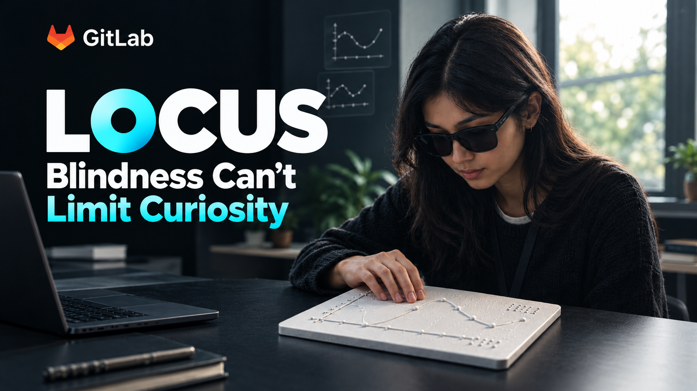
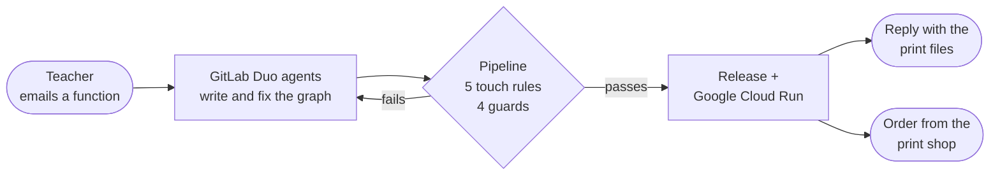

<p align="center">
  
</p>

<h1 align="center">Locus</h1>

<p align="center">
  <b>A teacher emails a maths function. GitLab Duo agents turn it into a raised-line graph a blind student reads by
  touch, check it the way a fingertip would, fix their own mistakes, ship it, and order the print.</b>
</p>

<p align="center">
  <a href="https://gitlab.com/gitlab-ai-hackathon/transcend-october-2026/43384339/showcase/-/pipelines"></a>
  <a href="LICENSE"></a>
  <a href="https://locus-site-742642312166.us-central1.run.app"></a>
</p>

<p align="center">
  <a href="https://locus-site-742642312166.us-central1.run.app"><b>Live graph library</b></a> ·
  <a href="#see-it-working"><b>See it working</b></a> ·
  <a href="docs/architecture.md"><b>How it works</b></a> ·
  <a href="docs/setup.md"><b>Set it up</b></a>
</p>

---

## Why

A sighted student learns what a parabola looks like in seconds. A blind student needs a **tactile graph**: raised
lines, raised points and braille labels on a plate they can explore with their fingertips. Making one well is
specialist work: tactile design rules, braille, and around
[two hours per chart by hand in CAD](https://www.emergentmind.com/papers/2607.01214).

Locus makes a checked, print-ready tactile graph from one email, in minutes, and sends it to the print shop.

## What it does



1. **Ask in plain words.** "Tomorrow I'm teaching quadratics. Please make y = 0.5x^2 - 2x + 5 from x = -0.5 to 4.5.
   The students should find the lowest point and where the curve crosses the y-axis." The site's Request page drafts
   this email, and can turn spoken maths into written maths.
2. **Agents build it.** The `locus-request` Duo flow reads the request, writes the graph, and opens a merge request.
3. **The pipeline checks it by touch.** Five measured rules: lines far enough apart for a fingertip to tell them apart,
   labels clear of lines and of each other, every requested point present, everything on the plate. Four guards prove
   the agents changed only what they may and kept the maths exact.
4. **Agents fix what fails.** The fixer reads the touch report and changes only the layout, using only the fixes each
   rule allows, up to three attempts. If a request cannot be made readable, it explains why instead of shipping.
5. **It ships itself.** A green merge request merges, releases `graph-<iid>-v<n>`, publishes to the Package
   Registry, deploys to Cloud Run through staging, replies to the teacher, and orders the prints.

Every plate carries a **braille ID** (G4 for request 4), so any print in a classroom traces back to its request, its
checks and the agent session that made it.

## See it working

Real runs in this project, with no person between the email and the reply:

| Run | What happened | Links |
|---|---|---|
| **Quadratic, three attempts** | Default layout failed TL-1 and TL-2. Fixer attempt 2 hid the grid and moved both labels; a label still touched a tick. Attempt 3 moved it 0.5 mm and passed. Auto-merged, released, deployed, replied, print order sent | [issue #4](https://gitlab.com/gitlab-ai-hackathon/transcend-october-2026/43384339/showcase/-/issues/4) · [MR !14](https://gitlab.com/gitlab-ai-hackathon/transcend-october-2026/43384339/showcase/-/merge_requests/14) · [release graph-4-v1](https://gitlab.com/gitlab-ai-hackathon/transcend-october-2026/43384339/showcase/-/releases/graph-4-v1) · [graph page](https://locus-site-742642312166.us-central1.run.app/graphs/graph-4-v1/) |
| **Cubic** | Two turning points and the y-intercept, fixed by the agent and shipped | [issue #3](https://gitlab.com/gitlab-ai-hackathon/transcend-october-2026/43384339/showcase/-/issues/3) · [release graph-3-v1](https://gitlab.com/gitlab-ai-hackathon/transcend-october-2026/43384339/showcase/-/releases/graph-3-v1) · [graph page](https://locus-site-742642312166.us-central1.run.app/graphs/graph-3-v1/) |
| **Projectile** | The first graph through the full release side | [issue #2](https://gitlab.com/gitlab-ai-hackathon/transcend-october-2026/43384339/showcase/-/issues/2) · [release graph-2-v1](https://gitlab.com/gitlab-ai-hackathon/transcend-october-2026/43384339/showcase/-/releases/graph-2-v1) · [graph page](https://locus-site-742642312166.us-central1.run.app/graphs/graph-2-v1/) |
| **Print again** | A teacher asked for more copies from a graph page; the scheduled job ordered them and closed the issue | [issue #5](https://gitlab.com/gitlab-ai-hackathon/transcend-october-2026/43384339/showcase/-/issues/5) |
| **Impact review** | A code change to tick spacing would have altered shipped graphs; the `locus-ops` agent explained which and why on the merge request | [MR !9](https://gitlab.com/gitlab-ai-hackathon/transcend-october-2026/43384339/showcase/-/merge_requests/9) |

Everything the runs produced is public: [releases](https://gitlab.com/gitlab-ai-hackathon/transcend-october-2026/43384339/showcase/-/releases),
[packages](https://gitlab.com/gitlab-ai-hackathon/transcend-october-2026/43384339/showcase/-/packages),
[pipelines](https://gitlab.com/gitlab-ai-hackathon/transcend-october-2026/43384339/showcase/-/pipelines) and the
[live library](https://locus-site-742642312166.us-central1.run.app).

**Printed and felt.** Four prototype plates were 3D-printed and tested by touch. The plate the rules reject (print A)
was the one that could not be read; the plates they accept (prints B and C) could. The calibration piece confirmed the
1.2 mm raised curve and the 0.8 mm braille dots ([prints](tools/prints/README.md), [calibration](tools/calibration/README.md)).

## The touch rules

Measured on the rendered plate, in millimetres, from published tactile-graphics guidance
([details and sources](docs/touch-rules.md)):

| Rule | Checks | Value |
|---|---|---|
| **TL-1** | The curve is far enough from every other line to feel as a separate line | ≥ 3.2 mm |
| **TL-2** | Braille labels stay clear of lines and point marks | ≥ 6.4 mm / 3.2 mm |
| **TL-3** | Labels never overlap | none |
| **TL-4** | Every requested point and label is on the plate | all present |
| **TL-5** | Everything fits, with features thick enough to print and feel | ≥ 3 mm margin, ≥ 1 mm wide |

Each failing result comes with its plain-words message, the measured value, and the fixes the agent may use. The
overlay drawing marks every measurement on the plate, and the site shows it interactively.

## Built on GitLab

Locus uses GitLab as its whole operating system, from the inbox to production.

| GitLab feature | How Locus uses it |
|---|---|
| **Duo Agent Platform: custom flows** | `locus-request` (intake, three fixers, refuse) and `locus-ops` (triage, impact reviewer, regression detective), each its own service account |
| **Flow triggers** | Assign and Mention start a request; a failed pipeline starts the impact reviewer |
| **Service Desk + email to issue** | A teacher's email becomes the request issue |
| **Issue templates + quick actions** | The request form labels and assigns itself to the agent |
| **CI/CD** | 26 jobs over 7 stages: render, touch rules, guards, bundle, release, deploy, monitor |
| **Merge request auto-merge** | A green graph merge request merges itself, pinned to the checked commit |
| **Package Registry + Releases** | Every graph is a versioned package and a release tagged `graph-<iid>-v<n>` |
| **SAST + Secret Detection** | Required before any release |
| **OIDC ID tokens** | Keyless login to Google Cloud |
| **Pipeline schedules + inputs** | "Print again" orders, every 30 minutes |
| **CODEOWNERS + protected branches** | The maintainers own the rules, guards, pipeline and agents; only protected `main` deploys |

## Built on Google Cloud

| Service | Role |
|---|---|
| **Cloud Run** | Serves the graph library: one revision per pipeline, staging tag first, then production |
| **Cloud Build + Artifact Registry** | Builds and stores the site image (5 newest kept) |
| **Workload Identity Federation** | GitLab's protected `main` deploys with no key file anywhere |
| **Budgets** | A 5 USD alert; the service scales to zero |

Production is pinned or released by one file, [`deploy/gcp/production-revision`](deploy/gcp/production-revision):
rollback is a one-line merge request.

## Safety by design

The agents are powerful and fenced in. **Nothing ships unless every deterministic check passes**, and no agent can
mark its own work as passed.

- **The maths is locked** when the request is made (`request.lock.json`); `guard-maths` blocks any change.
- **Each agent writes only its own paths**, checked by commit author (`guard-scope`).
- **Every number in the learner description is computed**, never written by a model (`guard-description`).
- **Fixes come from a fixed list** per rule ([`remedies.json`](locus/touchcheck/remedies.json)); otherwise the agent
  refuses and explains.
- **Nothing from a request runs as code**: expressions are parsed against an allowlist.
- **Every code change re-checks every shipped graph**, so a library change can never silently alter a student's print.

More in [docs/safety.md](docs/safety.md).

## Get started

```sh
git clone https://gitlab.com/gitlab-ai-hackathon/transcend-october-2026/43384339/showcase.git locus
cd locus
npm run setup
```

One command installs Locus, checks the agent flows, renders a released graph, touch-checks it and checks your setup.
Open `out/setup-graph-4/graph.stl` in any 3D viewer and `overlay.svg` in a browser.

To run Locus in your own GitLab project, with your own agents and Cloud Run site, follow
[**docs/setup.md**](docs/setup.md): eight steps, and `npm run locus -- doctor` checks each one for you.

| Command | What it does |
|---|---|
| `npm run setup` | Install, check, render and touch-check a graph, check the setup |
| `npm run locus -- <spec.json or requests/<iid>/>` | Render: STL, SVG, description, scene |
| `npm run locus -- touchcheck <...>` | TL-1 to TL-5: report, overlay, `LOCUS_REPORT` line |
| `npm run locus -- guard <scope\|maths\|description\|revert> ...` | The four guards |
| `npm run locus -- recheck [--impact]` | Re-check every shipped graph with this code |
| `npm run locus -- doctor --project <path>` | Check a GitLab project's setup |
| `npm run test:locus` | The Locus test suite |

## Documentation

| | |
|---|---|
| [How it works](docs/architecture.md) | The journey, the agents, the pipeline, release and deploy, in diagrams |
| [Set it up](docs/setup.md) | From a clone to teachers emailing requests |
| [Touch rules](docs/touch-rules.md) | The five rules, how each is measured, and the allowed fixes |
| [Safety](docs/safety.md) | Why hands-off is responsible here |
| [Contracts](docs/contracts.md) | The fixed interfaces between every part |
| [Related work](docs/related-work.md) | How Locus compares with existing tactile-graph tools |

## Built on JSCAD

Locus is built on [JSCAD](https://github.com/jscad/OpenJSCAD.org) (MIT), imported with its full history: every curve,
axis, point and braille dot on a plate is a JSCAD solid. The upstream tests run in the Locus pipeline
(`upstream-test`, Node 20 and 22, migrated from GitHub Actions), and every change to the modelling library is checked
against every shipped graph: a downstream contract test that JSCAD never had. JSCAD's original README is
[README.jscad.md](README.jscad.md).

## Team

- **Shawki** ([@ahammadshawki8](https://gitlab.com/ahammadshawki8))
- **Ashfaq** ([@Ashfaq909](https://gitlab.com/Ashfaq909))
- **Nourin Richi** ([@nourin.richi.2026](https://gitlab.com/nourin.richi.2026))

Every agent inside Locus runs on the GitLab Duo Agent Platform.

## Licence

MIT, like JSCAD. See [LICENSE](LICENSE).
