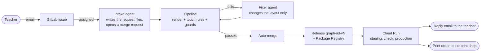
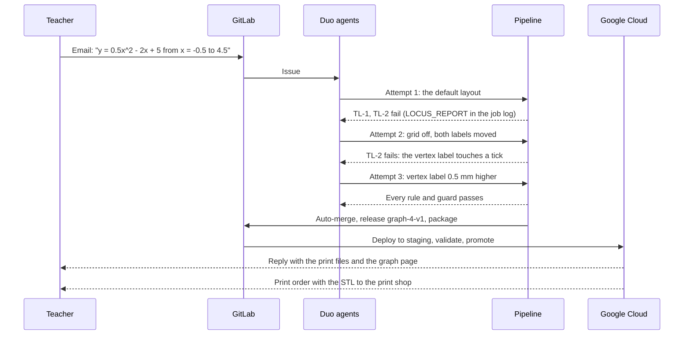
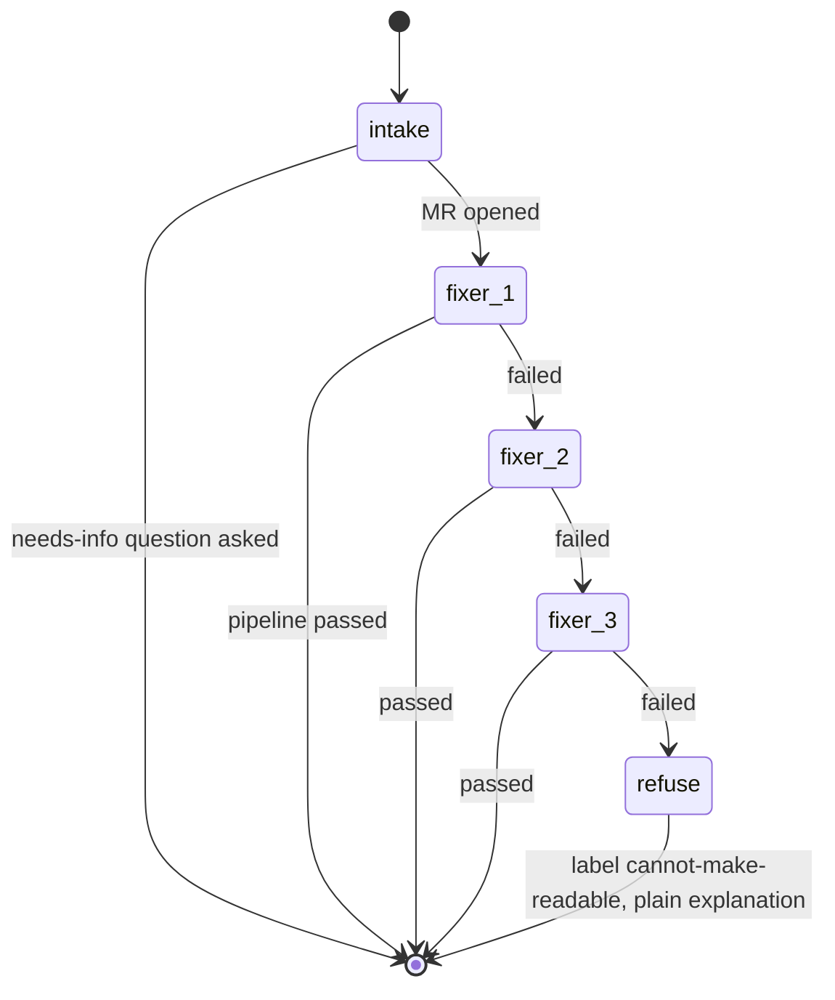
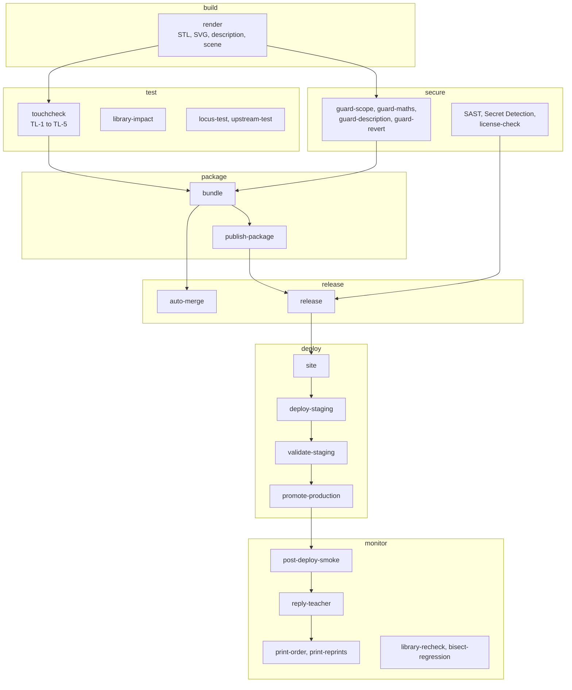
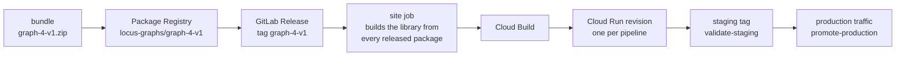

# How Locus works

Locus turns a teacher's email into a 3D-printable tactile graph that a blind student reads with their fingertips. Two
GitLab Duo agents do the thinking, the GitLab pipeline does the judging, and Google Cloud serves the result. This page
walks through every part.

- [The whole journey](#the-whole-journey)
- [The agents](#the-agents)
- [The pipeline is the judge](#the-pipeline-is-the-judge)
- [What a graph is made of](#what-a-graph-is-made-of)
- [Release, deploy and reply](#release-deploy-and-reply)
- [Keeping every shipped graph correct](#keeping-every-shipped-graph-correct)
- [Print orders](#print-orders)
- [Code map](#code-map)

## The whole journey



1. **The teacher emails** a function, an x range and the points to mark, in plain words. The Request page on the site
   drafts that email for them, and can turn spoken maths into written maths.
2. **GitLab turns the email into an issue** and assigns it to the `locus-request` flow, which starts the agents.
3. **The intake agent** reads the request, writes `requests/<iid>/{spec.json, request.lock.json, layout.json}` on a
   `graph/<iid>` branch and opens a merge request.
4. **The pipeline renders the plate and measures it** against five touch rules and four guards.
5. **The fixer agent** reads the touch report from the job log and commits a better layout, using only the fixes the
   rules allow. It has up to three attempts.
6. **A green merge request merges itself.** The default branch pipeline releases the graph, publishes it to the
   Package Registry, deploys the site to Cloud Run staging, checks staging, promotes it to production, replies to the
   teacher and, when the school has turned it on, orders the prints.

A real run, issue #4 (`y = 0.5x^2 - 2x + 5`): one email, three attempts, auto-merged, released as `graph-4-v1`, live
on the site and ordered from the print shop, with no person in between.



## The agents

Both flows live in [`.gitlab/duo/flows/`](../.gitlab/duo/flows/) and run on the GitLab Duo Agent Platform. Each runs as
its own service account, so every agent commit is attributable and checked.

| Flow | Steps | Starts when | Can write |
|---|---|---|---|
| `locus-request` | intake, fixer 1 to 3, refuse | A person assigns a request issue to it, or mentions it on a Service Desk ticket | `requests/<iid>/` on `graph/<iid>` only |
| `locus-ops` | triage, impact reviewer, regression detective | A person's pipeline fails, or a person assigns a regression issue | Notes, and `revert/<sha>` branches through `guard-revert` |



- **The intake agent** turns words into a locked spec. If something is missing it asks one question (`needs-info`)
  instead of guessing.
- **The fixer agent** reads the `LOCUS_REPORT` line from its own `touchcheck` job log and applies only the remedies
  listed for each failing rule in [`remedies.json`](../locus/touchcheck/remedies.json): rescale an axis, hide the grid,
  move a label, switch labels to a key, reduce the scale. It can never change the maths or the rules.
- **The refuse step** explains in plain words why a request cannot be made readable, and suggests what the teacher
  could change. Nothing unreadable is ever shipped.
- **The impact reviewer** (`locus-ops`) runs when a code change would alter a shipped graph. It reads the
  `library-impact` report and explains on the merge request which graphs would change and why.
- **The regression detective** (`locus-ops`) takes a `regression` issue, uses the first bad commit that
  `bisect-regression` found, and proposes an exact revert on a `revert/<sha>` branch.

## The pipeline is the judge

The agents propose; the pipeline decides. No agent can mark its own work as passed.



| Gate | What it proves |
|---|---|
| `touchcheck` | The plate is readable by touch: lines far enough apart, labels clear of lines and of each other, every requested point present, everything on the plate ([touch rules](touch-rules.md)) |
| `guard-scope` | Each agent changed only its own files on its own branch, checked by commit author |
| `guard-maths` | The function is exactly the one the teacher asked for (`request.lock.json`), and every plotted point is on it |
| `guard-description` | Every number in the learner description is a computed value |
| `guard-revert` | A revert is the exact inverse of the commit it names |
| SAST, Secret Detection, `license-check` | No vulnerable code, no secrets, permissive licences only |
| `validate-staging`, `post-deploy-smoke` | The live site serves this commit's build, every page as a page, and every file with exactly the hash in its manifest |

The full rules for each gate, and the files each part reads and writes, are in [contracts.md](contracts.md).

## What a graph is made of

Every request folder holds three files, and every release holds the same bundle:

| File | Written by | What it is |
|---|---|---|
| `spec.json` | Intake agent | The maths: coefficients, x range, the points to mark |
| `request.lock.json` | Intake agent, once | A hash of the spec. `guard-maths` blocks any later change |
| `layout.json` | Intake, then the fixer | Scales, grid, label positions: the only thing the fixer may change |
| `graph.stl` | `render` | The printable plate, 100 x 100 mm, watertight |
| `graph.svg`, `overlay.svg` | `render`, `touchcheck` | The drawing, and the same drawing with every touch measurement marked |
| `description.txt` | `render` | A plain-text description for the learner, with computed values only |
| `manifest.json` | `bundle` | Hashes of every file, the checks, the commit, the pipeline and the agent sessions |

Every plate carries a **braille ID** (for example G4 for request 4) in the top-right corner, so any print in a
classroom can be traced back to its request, its checks and the agent session that made it.

Rendering uses [JSCAD](https://github.com/jscad/OpenJSCAD.org) (`packages/modeling`, imported with its full history):
the curve, axes, ticks, point marks and braille dots are JSCAD solids, unioned into one watertight mesh. The
polynomial is evaluated by a small parser with an allowlist; nothing from a request is ever run as code.

## Release, deploy and reply



- **Keyless Google Cloud login.** The deploy jobs use GitLab's OIDC ID token and Workload Identity Federation. Only
  this project's protected `main` branch can deploy, and there is no service account key anywhere.
- **Every pipeline gets its own revision**, first on a `staging` tag with no traffic. `validate-staging` reads it like
  a visitor would before production moves.
- **GitOps rollback.** [`deploy/gcp/production-revision`](../deploy/gcp/production-revision) is `UNSET` (promote each
  release) or the name of one revision to pin production to. A rollback is a one-line merge request.
- **The site serves exactly what was released.** It is built from the Package Registry files, never re-rendered.
- **The reply** posts the summary on the request issue: what was made, the checks it passed, the download links and
  the graph page. GitLab emails it to the teacher, and the issue is closed.

## Keeping every shipped graph correct

Locus treats JSCAD as a dependency that can break shipped graphs, and tests for it.

- **`library-impact`** (merge requests): renders every shipped graph with the proposed code and reports any change in
  geometry or touch results. The impact reviewer explains it on the merge request.
- **`library-recheck`** (every main pipeline): re-checks every shipped graph with the current code.
- **`bisect-regression`**: when a re-check fails, finds the first bad commit with `git bisect`, per graph.

This is a downstream contract test for JSCAD: a change to the modelling library that would silently change a
student's print is caught before it ships.

## Print orders

Locus can close the loop from lesson idea to a print in hand. When the school turns print orders on:

- **`print-order`** emails the school's print shop for every released graph, with the STL attached and the number of
  copies from the request ("Printed copies needed: N"; 0 means digital files only).
- **`print-reprints`** runs on a 30-minute schedule. A teacher presses **Print again** on any graph page, which files a
  `reprint` issue; the job orders those copies and closes the issue.

Mail is sent over SMTP with the password read from a masked CI variable on standard input, never on a command line or
in a log.

## Code map

```text
locus/
  core/        spec schema, polynomial parser, placement, JSCAD solids, STL, SVG, braille, description, bundle
  touchcheck/  rules TL-1 to TL-5, the report, the overlay, remedies.json (the fixes the agent may use)
  guards/      guard-scope, guard-maths, guard-description, guard-revert
  release/     auto-merge, license-check, publish, release, reply, print-order, print-reprints
  site/        the graph library site, its 3D viewer and its post-deploy check
  flows/       the schema check for the Duo flow files
  cli/         `npm run locus -- ...`: every command above, plus setup and doctor
profiles/      printer profiles (feature sizes and rule values)
requests/      one folder per teacher request, written by the agents
deploy/gcp/    Cloud Run setup, deploy and the production pointer
.gitlab/       Duo flows, the request issue template, CODEOWNERS
packages/      JSCAD (MIT), the modelling library Locus is built on
```
