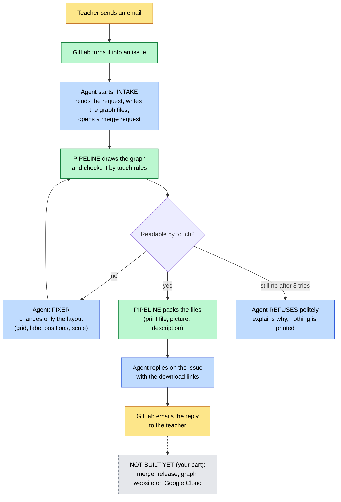
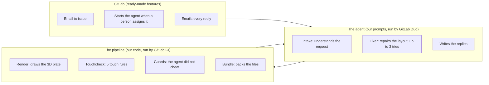
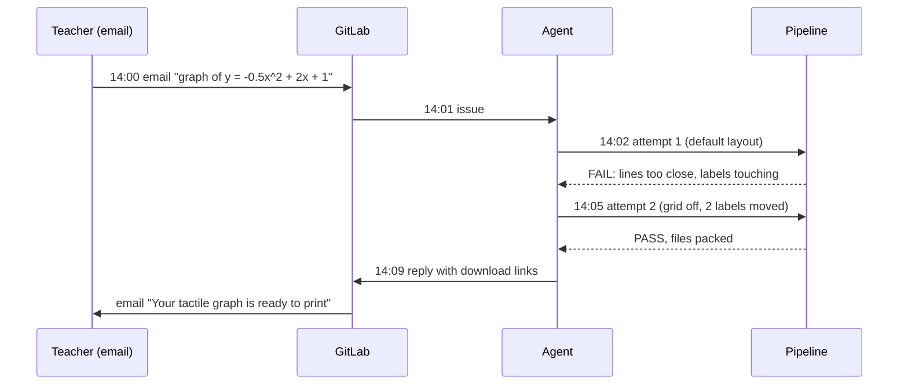
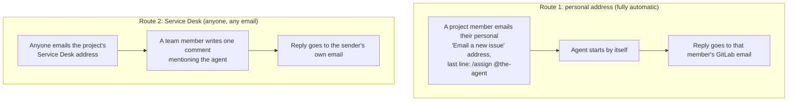

# How Locus works (the short version, for Shawki)

No code here. Just what each part does, in pictures, and how to test it yourself. The details live in
[HANDOVER.md](../HANDOVER.md); the evidence for every claim is in [decisions.md](decisions.md).

## In one line

A teacher **emails** a maths function. A **GitLab Duo agent** turns it into a raised-line graph a blind student can
read by touch. **GitLab's pipeline** checks it the way a fingertip would. If it fails, the agent **fixes its own
layout** and tries again. When it passes, the teacher gets the **print file back by email**.

## The whole flow



Yellow is a person or an email, blue is the AI agent, green is GitLab and our pipeline, grey is not built yet.

## Who does what



| Part | Think of it as | Where it lives |
|---|---|---|
| **GitLab features** | The post office: takes the email in, sends replies out, starts the agent | GitLab settings |
| **The agent** | The worker: reads, writes, fixes, replies. It can only change the layout, never the rules or the maths | `.gitlab/duo/flows/locus-request.yml` (pasted into GitLab's AI Catalog) |
| **The pipeline** | The inspector: decides pass or fail. The agent can never mark its own work as passed | `.gitlab-ci.yml` |
| **The Locus code** | The tools the inspector uses: drawing, measuring, checking | `locus/` |

## What the inspector checks

```text
 ┌──────────────────────── TOUCH RULES (is it readable by a fingertip?) ─────────────────────────┐
 │ TL-1  lines at least 3.2 mm apart      TL-2  labels do not touch lines                         │
 │ TL-3  labels do not overlap            TL-4  every point asked for is on the plate             │
 │ TL-5  everything fits inside the plate                                                         │
 └────────────────────────────────────────────────────────────────────────────────────────────────┘
 ┌──────────────────────── GUARDS (did the agent stay honest?) ──────────────────────────────────┐
 │ scope        the agent changed only the files it is allowed to                                 │
 │ maths        the function itself was never changed                                             │
 │ description  every number in the text for the learner is true                                 │
 └────────────────────────────────────────────────────────────────────────────────────────────────┘
```

Every plate has a **braille ID** in the top-right corner (for example G7 for request 7), so any print can be traced
back to its request, its checks and the agent session that made it.

## A real run: request #7 (20 Oct)



About 8.5 minutes, and nobody touched anything after sending the email.

## Two ways to send a request



Why route 2 needs one comment: GitLab only starts an agent when a **person** acts, and Service Desk tickets are
created by GitLab's Support Bot, not a person.

## What is done and what is yours

```text
 DONE (Ashfaq)                                   YOURS (Shawki)
 ┌─────────────────────────────────────┐         ┌──────────────────────────────────────────┐
 │ email in, agent, touch check,       │         │ merge the green merge request            │
 │ self-fix, guards, files back        │  ────>  │ release it (tag graph-7-v1 etc.)         │
 │ by email, refusal after 3 tries     │         │ graph website on Google Cloud Run        │
 │ README "See it working"             │         │ final reply with the release link        │
 │ HANDOVER.md                         │         │ README polish, video, Devpost, freeze    │
 └─────────────────────────────────────┘         └──────────────────────────────────────────┘
```

Your task list, in order, with exact steps: [HANDOVER.md section 0](../HANDOVER.md).

## How you can test it

**1. Look at the real run (2 minutes, no account needed)**
- [Issue #7](https://gitlab.com/gitlab-ai-hackathon/transcend-october-2026/43396940/showcase/-/issues/7): the request,
  the agent's notes and the final reply with links.
- [Merge request !5](https://gitlab.com/gitlab-ai-hackathon/transcend-october-2026/43396940/showcase/-/merge_requests/5):
  open "Commits" (attempt 1, then the agent's fix) and "Pipelines" (red, then green).
- The two download links in the reply: the zip and the STL open without signing in.
- The refusal: [issue #6](https://gitlab.com/gitlab-ai-hackathon/transcend-october-2026/43396940/showcase/-/issues/6).

**2. Run the checker on your computer (5 minutes, needs Node 20)**

```sh
npm --prefix locus ci
npm run test:locus                                    # all tests pass
npm run locus -- examples/projectile.json             # draws the plate into out/projectile/
npm run locus -- touchcheck examples/projectile.json  # FAILS on purpose: the default layout
```

Open `out/projectile/overlay.svg` in a browser: red circles show where a fingertip would get confused.

**3. Send a real request by email (10 minutes)**
- **Today, in Ashfaq's test bed:** email a request from any address to the test bed's Service Desk address
  `incoming+gitlab-ai-hackathon-transcend-october-2026-43396940-showcase-87669530-issue-@incoming.gitlab.com`,
  then tell Ashfaq. He writes the one comment; your inbox gets the agent's notes and, about 8 minutes later, the
  download links. Example email:

  ```text
  Subject: Tactile graph: projectile
  Please make a tactile graph of y = -0.5x^2 + 2x + 1 for x from -0.5 to 4.5.
  Please mark the highest point and where the curve crosses the y-axis.
  ```
- **Later, in your own project:** after the setup in [HANDOVER.md section 13](../HANDOVER.md), use route 1 from your
  own personal address and it runs with nobody else involved.

**Good requests:** one line, parabola or cubic (nothing above x^3), numbers between -100 and 100, points like "the
highest point", "the turning points", "where it crosses the y-axis". A curve that only touches the x-axis, like
y = (x - 1)^2, is refused on purpose.

## Two rules to remember

- **Never fix a run by hand.** If something breaks, close the merge request with a note and send a fresh request.
- **At 27 Oct, 13:00 UTC switch every agent trigger off.** GitLab said a run during judging could change the repo
  and risk our eligibility. Judges see the recorded runs and the video instead.
