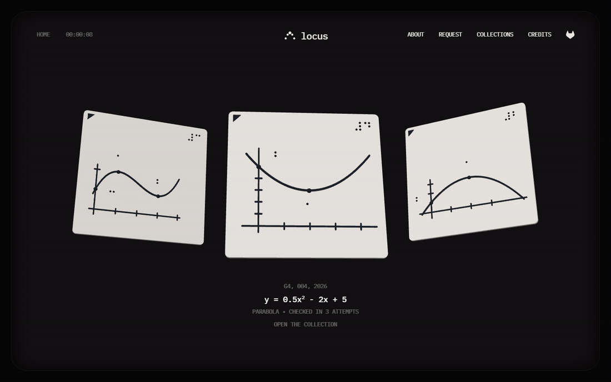
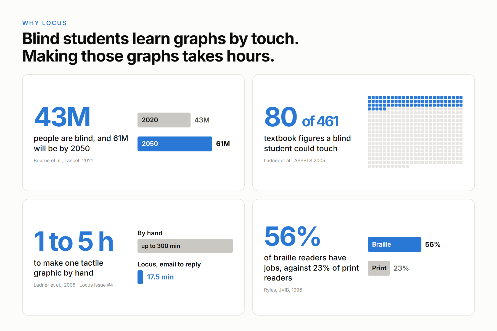
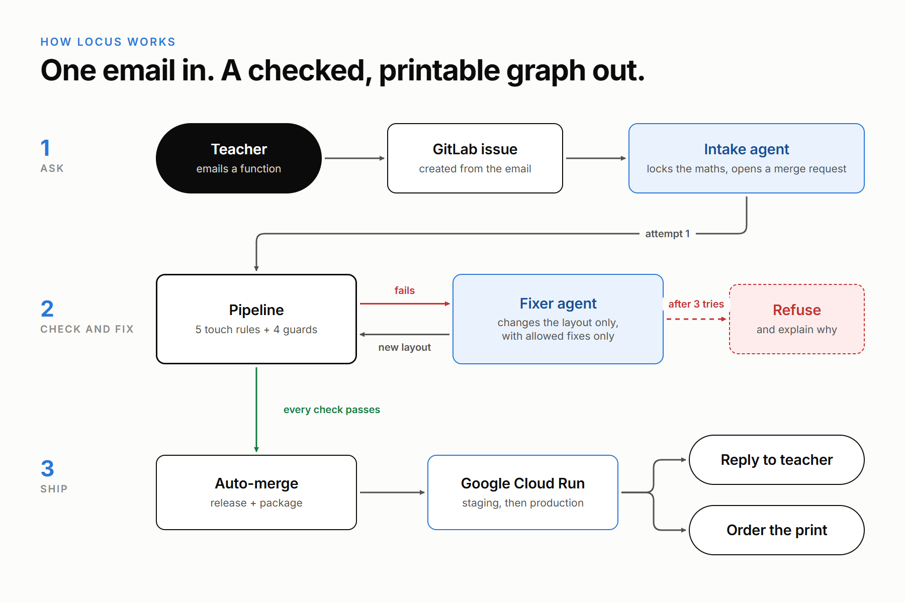
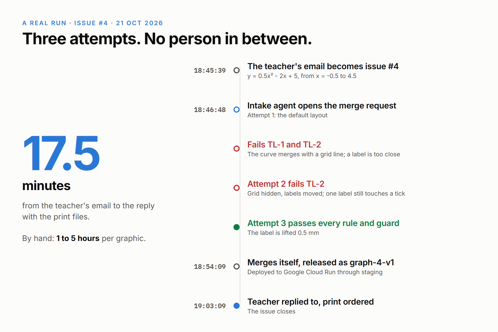
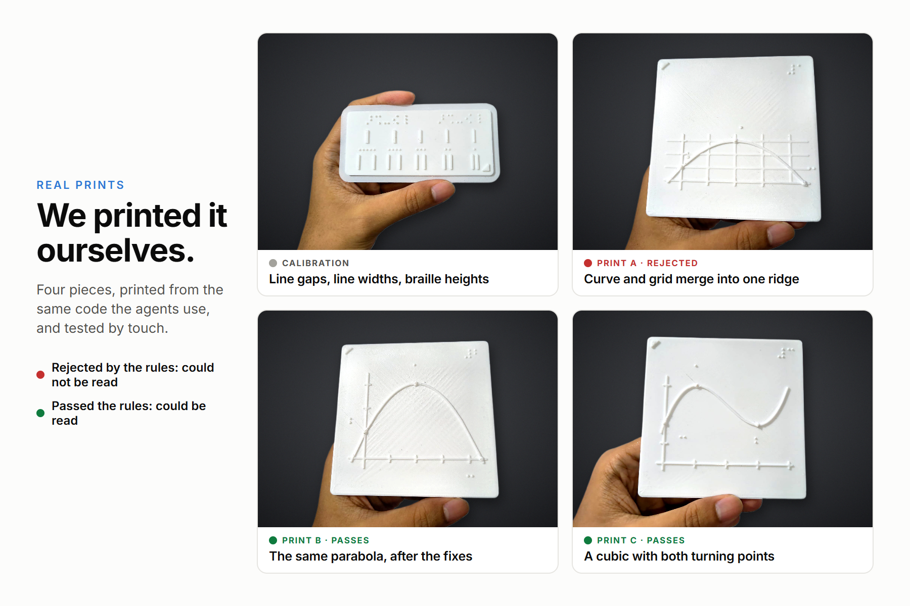
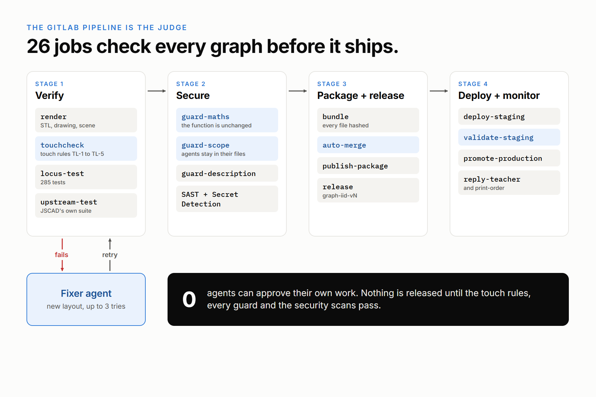
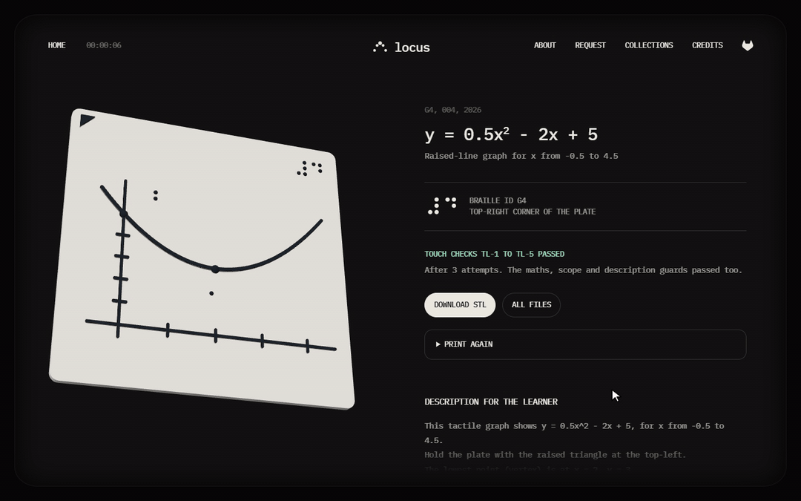
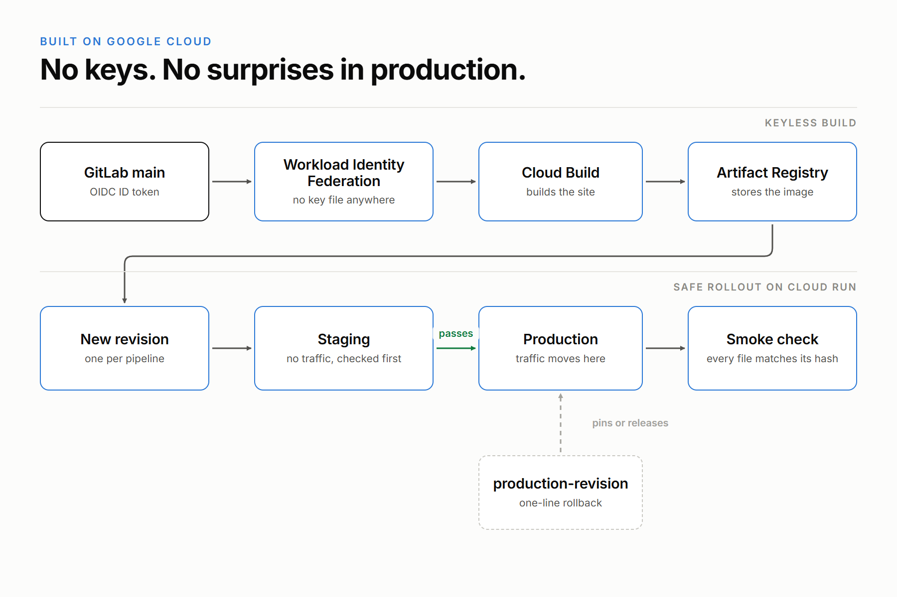

# Locus

**Locus lets any maths teacher give a blind student the same graph the rest of the class sees, as a 3D-printed plate
they can read with their fingertips.**

The teacher simply emails the function they are teaching, in plain words. From there, AI agents on the GitLab Duo
Agent Platform do the specialist work: they design a raised-line graph with braille labels, measure it against
research-based touch rules, correct their own mistakes, publish the finished graph on Google Cloud, send the print
files back to the teacher and order the print. The teacher needs no tactile-graphics training, no CAD skills and no
spare hours.

- **Live graph library on Google Cloud Run:** https://locus-site-742642312166.us-central1.run.app
- **Source code and pipelines (MIT):** https://gitlab.com/gitlab-ai-hackathon/transcend-october-2026/43384339/showcase
- **Built on:** [JSCAD](https://github.com/jscad/OpenJSCAD.org) (MIT), imported with its full history
- **Entered in:** Path B (Bring Your Own), Hands-off. The teacher sends one email. The next time anyone looks, the
  graph is released, live, sent back to the teacher and ordered from the print shop.

## The graph the blind student never sees

Sangyun Hahn lost his sight when he was six. He went from a school for the blind in Korea to a computer science PhD at
the University of Washington. Looking back, he wrote: "The most difficult part was to obtain books in an accessible
format", and "I had to stay up over many nights"
([his own account](https://homes.cs.washington.edu/~ladner/hahnexperiences.html)).

His research group measured the problem. In one computer architecture textbook, a blind graduate student had tactile
access to only **80 of its 461 figures**. Turning a single figure into a tactile graphic by hand took **1 to 5 hours**,
which adds up to **200 to 1,000 hours for one textbook**
([Ladner et al., ASSETS 2005](https://doi.org/10.1145/1090785.1090814)).

Two decades later, the cost has barely moved. A 2026 study still reports **about two hours per chart** of manual
modelling ([Obiuwevwi et al., 2026](https://arxiv.org/abs/2607.01214)).

Picture what that means in a classroom tomorrow morning. A maths teacher draws a parabola on the board, and every
sighted student sees its shape at a glance. The blind student in the same room hears "it curves upwards", and has to
imagine the rest. The teacher wants to help, but has no tactile-graphics training, no CAD skills and no two spare
hours.

**Locus is built for that teacher. One email in plain words becomes a checked, print-ready tactile graph in minutes.**

*The live graph library on Google Cloud Run. Every plate here came from a teacher's request and passed every touch
rule and guard before release.*

## Inspiration

Hahn's story was our starting point, but the research showed us it was not an exception. Four findings shaped what we
built.

- **The audience is large.** An estimated **43.3 million people were blind in 2020**, and the number is forecast to
  reach 61 million by 2050 ([Bourne et al., Lancet Global Health 2021](https://pubmed.ncbi.nlm.nih.gov/33275950/)).
  Blind students follow the same maths curriculum as everyone else, and that curriculum is full of graphs.
- **Making graphics is the bottleneck.** Teachers of blind pupils name the labour of producing tactile graphics as a
  key problem ([Sheppard and Aldrich, 2001](https://research.gold.ac.uk/1868)), and pupils describe the difficulties
  from their side as well ([Aldrich and Sheppard, 2001](https://sro.sussex.ac.uk/id/eprint/13653/)). Twenty years on,
  teachers of the visually impaired still prefer 3D models but describe them as "difficult to create, obtain, and
  modify" ([Phutane et al., ACM TACCESS](https://arxiv.org/abs/2202.12280)).
- **Touch works when the graphic is made well.** Studies of 3D-printed maths graphs show they help visually impaired
  students identify graphs ([Visio SenseMath study](https://www.visio.org/visio.org/media/Visio/Downloads/KEI/Vision-2017/Does-multisensory-presentation-of-mathematical-graphs-improve-visually-impaired-students-performance-on-identifying-mathematical-graphs-A-comparison.pdf)),
  and a systematic review of 292 papers links the growth of touch-based graphics research since 2014 to affordable 3D
  printing ([Butler et al., CHI 2021](https://arxiv.org/abs/2102.01273)).
- **Braille matters beyond the classroom.** In one study, 56% of adults who learned to read in braille were employed,
  compared with 23% of those who learned in print ([Ryles, JVIB 1996](https://nfb.org/node/8292)). That is why every
  Locus plate is labelled in braille.

Together, these findings pointed to a gap that drawing software alone does not close. A tactile graph can look perfect
on screen and still feel like a single tangled ridge under a fingertip. What a teacher really needs is a graph that has
been **measured for touch before it reaches the student**, corrected when it fails, and traceable afterwards. Locus
delivers that, using AI agents that are held to strict, deterministic checks.

## What it does

From the teacher's side, Locus is just an email conversation. Behind that email, a team of agents and a full GitLab
pipeline do the specialist work.

- **The teacher asks in plain words.** For example: "Tomorrow I'm teaching quadratics. Please make y = 0.5x^2 - 2x + 5
  from x = -0.5 to 4.5. The students should find the lowest point and where the curve crosses the y-axis." The Request
  page on our site helps draft this email from typed or spoken words.
- **GitLab turns the email into an issue** and assigns it to the `locus-request` Duo flow.
- **The intake agent reads the request** and writes it as a locked specification (`spec.json`, `request.lock.json`,
  `layout.json`) on its own branch, then opens a merge request. If something important is missing, it asks the
  teacher one clear question instead of guessing.
- **The pipeline builds the plate and measures it by touch.** Five touch rules (TL-1 to TL-5) and four guards decide
  whether the plate is readable and whether the agent stayed within its limits.
- **The fixer agent corrects what fails.** It reads the touch report and adjusts only the layout, using only the fixes
  each rule allows, with up to three attempts.
- **When a graph cannot be made readable, the agent says so.** It explains to the teacher in plain words what to
  change. Nothing unreadable is ever shipped.
- **A passing graph ships itself.** The merge request merges, the graph is released as `graph-<iid>-v<n>` and
  published, and the site is deployed to Google Cloud Run through staging.
- **The loop closes with real-world delivery.** The teacher receives the printable STL file, the drawings, a
  plain-text description for the learner and a link to the graph page, while the print shop receives the order with
  the STL attached.
- **Teachers can order more copies.** A Print again button on every graph page files a request, and a scheduled
  pipeline places the order.
- **Every plate is traceable.** A braille ID on each plate (G4 for request 4) links any print in a classroom back to
  its request, its checks and the agent session that made it.

## A real run: from email to print order in 17.5 minutes

This is not a scripted demo. Here is exactly what happened on issue #4, with no person involved between the email and
the reply.

- **18:45:39 UTC.** The teacher's email becomes issue #4.
- **18:46:48.** The intake agent opens merge request !14, 69 seconds later.
- **Attempt 1 (the default layout) fails two rules.** At the lowest point the curve runs into a grid line (TL-1), and
  a label sits too close to a line (TL-2).
- **Attempt 2 improves it.** The fixer hides the grid and moves both labels, but TL-2 still fails: the vertex label
  touches a tick mark.
- **Attempt 3 passes.** The fixer lifts that label by 0.5 mm, and every rule and every guard passes.
- **18:54:09.** The merge request merges itself. The pipeline releases `graph-4-v1`, publishes the package, deploys
  to staging, validates it, promotes it to production, replies to the teacher and orders the print.
- **19:03:09.** The issue closes with the reply: **17.5 minutes from email to reply**, compared with hours of
  specialist work by hand.

Every step of this run is public: [issue #4](https://gitlab.com/gitlab-ai-hackathon/transcend-october-2026/43384339/showcase/-/issues/4),
[MR !14](https://gitlab.com/gitlab-ai-hackathon/transcend-october-2026/43384339/showcase/-/merge_requests/14),
[release graph-4-v1](https://gitlab.com/gitlab-ai-hackathon/transcend-october-2026/43384339/showcase/-/releases/graph-4-v1)
and the [graph page](https://locus-site-742642312166.us-central1.run.app/graphs/graph-4-v1/). The projectile (#2) and
cubic (#3) requests, the Print again order (#5) and the impact review (MR !9) are public too.

## We printed it ourselves

A tactile graph only matters if it works in someone's hands, so we did not stop at the screen. We 3D-printed four
prototype pieces from the same code and the same layouts the agents use, and tested them by touch. The collage below
shows those real prints.

- **A calibration piece first.** Before printing any graph, we printed a test strip with line pairs at different gaps,
  lines of different widths and the word LOCUS in braille at two dot heights. Feeling it by hand set our profile: a
  1.2 mm raised curve and 0.8 mm braille dots read best.
- **Print A, the one the rules reject.** Printed from the default layout, with the grid on, it fails TL-1, TL-2 and
  TL-5. By touch, it could not be read where the curve meets the grid line: the two merge into one ridge.
- **Print B, the corrected version.** The same request after only the allowed fixes: grid hidden, scale changed,
  labels moved. It passes every rule, and by touch it could be read.
- **Print C, a different curve.** A cubic with two turning points, to show that Locus is not a one-graph trick. It
  passes every rule and could be read by touch as well.
- **The prints and the code agree.** The Locus renderer reproduces these printed plates exactly, and a test checks it
  in every pipeline. Probe measurements of the meshes match the designed feature sizes.
- **Easy to print anywhere.** Each graph plate is 100 x 100 x 3.6 mm in PLA, printed flat with no supports, using
  about 23 to 25 g of filament.

With the physical result proven, the rest of this story explains how Locus produces it automatically.

## How we built it

Locus rests on four layers that each do one job well: JSCAD builds the geometry, GitLab Duo agents do the reasoning,
the GitLab pipeline acts as an impartial judge, and Google Cloud serves the result. The sections below follow that
order.

### JSCAD: the foundation, with our thanks

Every Locus plate exists because of [JSCAD](https://github.com/jscad/OpenJSCAD.org), the open-source modelling library
its maintainers have built over many years.

- **Every plate is JSCAD geometry.** The curve, axes, ticks, point domes, orientation triangle and every braille dot
  are JSCAD solids from `@jscad/modeling`, joined into one watertight 100 x 100 mm STL file.
- **We imported it with its full history.** JSCAD came into GitLab with every commit from its maintainers and keeps its
  MIT licence.
- **Its own tests run in our pipeline.** We migrated JSCAD's GitHub Actions workflow to the GitLab job
  `upstream-test`, which runs on Node 20 and 22.
- **We gave JSCAD a safety net it did not have.** Every change to the modelling code re-renders every graph already
  shipped and compares its geometry and touch results, so a library change can never quietly alter a print in a
  student's hands.
- **Nothing from a request is run as code.** Functions are read by a small parser that accepts only known maths
  operations; there is no `eval` anywhere.

### GitLab Duo Agent Platform: two custom flows

With the geometry in place, the agents provide the judgement that a human specialist would otherwise supply. They
work in two custom flows.

- **`locus-request`** has five steps: intake, three fixers and a refusal step. It starts when a request issue is
  assigned to it.
- **`locus-ops`** has three steps: triage, an impact reviewer and a regression detective. It starts when a pipeline
  fails or a regression issue is filed.
- **Each flow runs under its own service account,** so every agent commit can be traced and checked by its author.
- **The agents propose and the pipeline decides.** The fixer reads the `LOCUS_REPORT` line from its own `touchcheck`
  job and may use only the fixes listed for each failing rule in `remedies.json`: rescale an axis, hide the grid, move
  a label, switch labels to a key, or reduce the scale. It can never change the maths, the rules or its own scope.
- **The impact reviewer** explains on a merge request which shipped graphs a code change would alter, and why
  ([MR !9](https://gitlab.com/gitlab-ai-hackathon/transcend-october-2026/43384339/showcase/-/merge_requests/9)).
- **The regression detective** takes the first faulty commit that `git bisect` has found and proposes an exact
  revert, which `guard-revert` proves is a true inverse.

### The pipeline: every DevSecOps stage, used for real

Agents are only as trustworthy as the system that checks them. In Locus that system is the GitLab pipeline: **26 jobs
across 7 pipeline stages**, which together reach all nine DevSecOps stages.

| Stage | How Locus uses it |
|---|---|
| **Plan** | Service Desk turns emails into issues; an issue template, quick actions and labels such as `needs-info` and `reprint`; the triage agent |
| **Create** | The intake agent writes the request files and opens the merge request; the fixer commits improved layouts |
| **Verify** | `render`, `touchcheck` (TL-1 to TL-5), `locus-test` (285 tests), `upstream-test`, `library-impact` |
| **Package** | `bundle` (every file hashed in a generated manifest) and `publish-package` to the Package Registry |
| **Secure** | SAST, Secret Detection, `guard-scope`, `guard-maths`, `guard-description`, `guard-revert` |
| **Release** | `auto-merge` pinned to the exact commit that was checked; `release` tagged `graph-<iid>-v<n>` |
| **Configure** | OIDC ID tokens for keyless deployment, the GitOps `production-revision` pointer, pipeline inputs and schedules |
| **Monitor** | `validate-staging`, `post-deploy-smoke`, `library-recheck`, `bisect-regression`, the regression detective |
| **Govern** | CODEOWNERS, protected branches, a service account per agent, `license-check`, DCO sign-off |

### The touch rules: grounded in research, confirmed by hand

The heart of that pipeline is `touchcheck`. It measures the rendered plate, the same geometry the STL file is made
from, in real millimetres, sampled every 0.5 mm. The rule values live in a printer profile rather than in the code, so
they can be tuned without touching the logic.

| Rule | What it checks | Value | Grounded in |
|---|---|---|---|
| **TL-1** | The curve is far enough from every other line to feel separate | ≥ 3.2 mm | 1/8 inch minimum, [tactilegraphics.org](https://tactilegraphics.org/readability.html) |
| **TL-2** | Braille labels stay clear of lines and point marks | ≥ 6.4 mm / 3.2 mm | 1/4 inch separation, [tactilegraphics.org](https://tactilegraphics.org/readability.html); [NPS 2008](https://www.npshistory.com/publications/interpretation/hfc/tactile-map-guidelines-2008.pdf) |
| **TL-3** | Labels never overlap | none | label box intersection |
| **TL-4** | Every requested point and label is on the plate | all present | inventory |
| **TL-5** | Everything fits, and features are thick enough to print and feel | ≥ 3 mm margin, ≥ 1 mm wide | printer profile |

- **Braille in standard proportions.** Braille cells sit 6.2 mm apart, the nominal cell spacing in
  [NLS Specification 800](https://www.brailleauthority.org/node/63).
- **Confirmed with a calibration print.** We printed a test plate with different line gaps, line widths and two braille
  dot heights. By touch, a 1.2 mm raised curve and 0.8 mm braille dots read best, so those became our profile values.
- **Every result is explained in plain words.** For example: "These lines are too close: a fingertip feels one line",
  followed by the measured value and the fixes allowed. An overlay drawing marks every measurement on the plate.

*The page for graph-4-v1. Pressing TL-1 to TL-5 highlights where each rule measured the plate, with the result in plain
words.*

### Google Cloud: delivering the graph library

Once a graph has passed, it needs a permanent, public home. Google Cloud provides it, through a deployment path with no
stored keys and a safety check before every release.

- **Cloud Run serves the library:** the newest plates in 3D (three.js), and a page for each graph with downloads, the
  touch overlay and the Print again button.
- **Cloud Build and Artifact Registry** build and store the site image.
- **Workload Identity Federation with GitLab OIDC ID tokens** means only the protected `main` branch can deploy, and
  no service account key exists anywhere.
- **Each pipeline gets its own revision,** first on a `staging` tag with no traffic. `validate-staging` browses it as a
  visitor would and checks every file against its manifest hash before production changes.
- **Rollback is a one-line change.** The `deploy/gcp/production-revision` file pins or releases production, so a
  rollback is a single-line merge request.
- **The service scales to zero,** with a budget alert in place.

### Safety by design

Because Locus runs without a person in the loop, safety cannot depend on good intentions. It is built into the
structure.

- **The maths is locked** when the request is made. `guard-maths` blocks any change to it and confirms that every
  plotted point lies on the requested function.
- **Each agent may write only its own files,** which `guard-scope` checks by commit author.
- **Every number in the learner description is calculated,** never written by a model (`guard-description`).
- **No agent can approve its own work.** A release requires `touchcheck`, every guard, SAST, Secret Detection and a
  complete bundle.

## Before and after (Path B)

Path B asks what an existing open-source project gains from GitLab's full lifecycle. For JSCAD, the difference is the
gap between a modelling library and a complete service.

- **Before:** JSCAD was a modelling library, tested on GitHub Actions. Making a tactile graph with it meant someone
  writing code or modelling in CAD, checking the result by eye, exporting files by hand and emailing them on.
- **After:** the same library sits at the centre of a hands-off GitLab lifecycle. An email starts the process; Duo
  agents write and correct the graph; the pipeline measures, guards, packages, releases and deploys it to Google
  Cloud; the teacher and the print shop are notified; and every shipped graph is checked again whenever the code
  changes.
- **What we built during the submission period:** JSCAD was imported on 14 Oct 2026 at upstream commit `f245ea3a`.
  Everything around it (the Locus renderer, the touch rules, the guards, both Duo flows, the 26-job pipeline, the Cloud
  Run deployment and the site) was built after 5 Oct 2026.

## Challenges we ran into

Each of these challenges taught us something, and each one left a lasting improvement in Locus.

- **A graph can look right and feel wrong.** Our first prototype print looked fine, but at the lowest point the curve
  and a grid line merged into a **single 1.64 mm ridge**, which a fingertip reads as one line. That print became the
  case rule TL-1 exists to reject, and a test now checks it.
- **Measuring touch rather than pixels.** A curve that genuinely crosses an axis must pass, while one that only brushes
  against it must fail. TL-1 therefore excuses only the short stretch where two lines are moving apart after a real
  crossing.
- **Watertight meshes.** Joining many small solids left hairline seams in the mesh. We now close them, and the build
  stops if a single mesh edge is left open, so every STL file prints cleanly.
- **Making agents safe without supervision.** We moved every judgement into deterministic code: a locked
  specification, a fixed list of fixes for each rule, scope checked by author, and computed numbers only.

## Accomplishments that we're proud of

Those solutions add up to a system we can stand behind, from the first email to the plate in a student's hands.

- **Real hands-off runs, all public.** Email to reply in 17.5 minutes on issue #4, with three agent attempts and no
  person involved.
- **The rules agree with real fingertips.** We printed our prototype plates and felt them. The plate the rules reject
  could not be read where the lines merge; the plates they accept could. Probe measurements of the STL meshes, taken
  independently of the code, match the designed feature sizes.
- **All nine DevSecOps stages,** each used for real work, from a Service Desk email to production monitoring.
- **285 Locus tests,** alongside JSCAD's own test suite, run in every pipeline.
- **Every shipped graph is re-checked whenever the code changes,** and an agent explains any impact.
- **Easy to try.** One command, `npm run setup`, installs Locus, renders a released graph, touch-checks it and checks
  your setup, and `locus doctor` verifies a whole GitLab project.

## What we learned

Building Locus changed how we think about both accessibility and AI agents.

- **Touch is its own medium.** A tactile graph is not a picture with raised ink. Spacing, line height and braille size
  decide whether it can be read at all.
- **Agents earn trust within clear limits.** The more we moved into deterministic checks, the more freedom we could
  safely give the agents.
- **GitLab can run the whole operation.** The inbox, the agents, the judge, the registry, releases, deployment and
  monitoring all live in one project.
- **Research first, then the printer.** Published tactile-graphics guidance gave us our starting values, and a
  calibration print confirmed them on our own hardware.

## What's next for Locus

Locus works end to end today. The next step is to put it in the hands of the people it was built for.

- **Partner with schools for the blind.** We want to work alongside teachers of the visually impaired, beginning in
  Bangladesh, so that Locus plates reach real maths lessons.
- **Pilot with NGOs and braille services.** Organisations that already support blind learners can run Locus in their
  own GitLab project and Cloud Run site by following `docs/setup.md`, and print locally.
- **Let blind students shape the rules.** Pilot lessons with blind students and their teachers will tune the profile
  values, so that every measurement Locus makes reflects what real fingertips tell us.
- **Build shared graph libraries for every curriculum.** Every released graph is versioned, traceable and free to
  reprint, so schools can share lessons with one another.

## Why Locus deserves Best Hands-off Agent (Path B)

The challenge describes a hands-off agent as one where you create an issue, and the next time you check in, it is
live. Locus does exactly that, and then goes one step further into the physical world.

- **Truly hands-off.** One email starts the whole process. Locus replies to the person who asked and orders the
  physical print.
- **Technological implementation.** Two custom Duo flows with eight steps, 26 CI jobs, four guards, five measured
  touch rules, keyless Google Cloud deployment through staging, and 285 tests. No job in the pipeline fakes a pass.
- **Design.** One coherent journey, from a lesson idea to a print in hand, with refusal and reprints built in.
- **Potential impact.** A real, well-documented problem (hours per graph, figures left out of textbooks) for a real
  audience: blind students and their teachers.
- **Innovation.** Agents that correct their own work against **physical, measured criteria**, and a pipeline that
  re-checks everything it has ever shipped whenever its code changes.
- **Most Stages Covered.** All nine stages, each doing real work rather than appearing for show.

## What makes Locus different

Many strong projects automate software delivery. Locus applies the same discipline to something a child can hold.

- **Most agent projects automate software for software.** Locus ends in a physical object in a student's hands.
- **Most agents mark their own work.** In Locus, the agents cannot approve themselves: deterministic touch rules and
  guards decide, and an agent refuses when it cannot meet them.
- **Most tactile-graphics tools stop at drawing.** Locus measures every plate for touch, corrects failures, ships
  only what passes and traces every print back to its checks.
- **Many Path B projects wrap an existing library.** Locus also protects it: every shipped graph acts as a
  regression test for JSCAD.

## Research behind Locus

- Ladner et al., [Automating tactile graphics translation](https://doi.org/10.1145/1090785.1090814), ASSETS 2005.
- Jayant et al., [Automated tactile graphics translation: in the field](https://doi.org/10.1145/1296843.1296858),
  ASSETS 2007: the Tactile Graphics Assistant translated more than 2,300 textbook figures.
- Obiuwevwi et al., [A reusable software pipeline for 3D-printed tactile statistical graphics](https://arxiv.org/abs/2607.01214),
  2026: JSCAD-based charts, and about two hours per chart by hand.
- Butler et al., [Technology developments in touch-based accessible graphics: a systematic review](https://arxiv.org/abs/2102.01273),
  CHI 2021.
- Phutane et al., [Tactile materials in practice: teachers of the visually impaired](https://arxiv.org/abs/2202.12280),
  ACM TACCESS.
- Aldrich and Sheppard, [Tactile graphics in school education: perspectives from pupils](https://sro.sussex.ac.uk/id/eprint/13653/),
  and Sheppard and Aldrich, [perspectives from teachers](https://research.gold.ac.uk/1868), British Journal of
  Visual Impairment, 2001.
- Brown and Hurst, [VizTouch: automatically generated tactile visualizations of coordinate spaces](https://doi.org/10.1145/2148131.2148160),
  TEI 2012.
- Hu, [Exploring new paradigms for accessible 3D printed graphs](https://doi.org/10.1145/2700648.2811330), ASSETS 2015.
- Bourne et al., [Trends in prevalence of blindness and vision impairment over 30 years](https://pubmed.ncbi.nlm.nih.gov/33275950/),
  Lancet Global Health, 2021.
- Ryles, [The impact of braille reading skills on employment, income, education and reading habits](https://nfb.org/node/8292),
  JVIB, 1996.
- Guidance: [tactilegraphics.org readability](https://tactilegraphics.org/readability.html),
  [BANA Guidelines and Standards for Tactile Graphics](https://www.brailleauthority.org/tg/),
  [NLS Specification 800 braille sizes](https://www.brailleauthority.org/node/63),
  [NPS tactile map guidelines](https://www.npshistory.com/publications/interpretation/hfc/tactile-map-guidelines-2008.pdf).

## Built with

JavaScript, Node.js, JSCAD, three.js, GitLab Duo Agent Platform, GitLab CI/CD, GitLab Service Desk, GitLab Package
Registry, GitLab Releases, SAST, Secret Detection, Google Cloud Run, Cloud Build, Artifact Registry, Workload Identity
Federation.

## Team

- **Shawki** ([@ahammadshawki8](https://gitlab.com/ahammadshawki8))
- **Ashfaq** ([@Ashfaq909](https://gitlab.com/Ashfaq909))
- **Nourin Richi** ([@nourin.richi.2026](https://gitlab.com/nourin.richi.2026))

Thank you for reading. Every child deserves to feel the shape of the maths their classmates can see.
